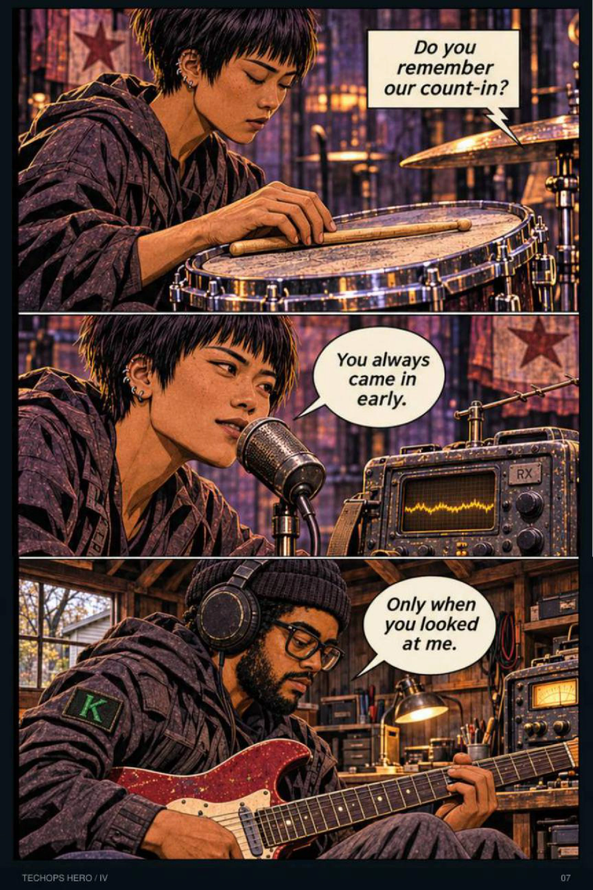
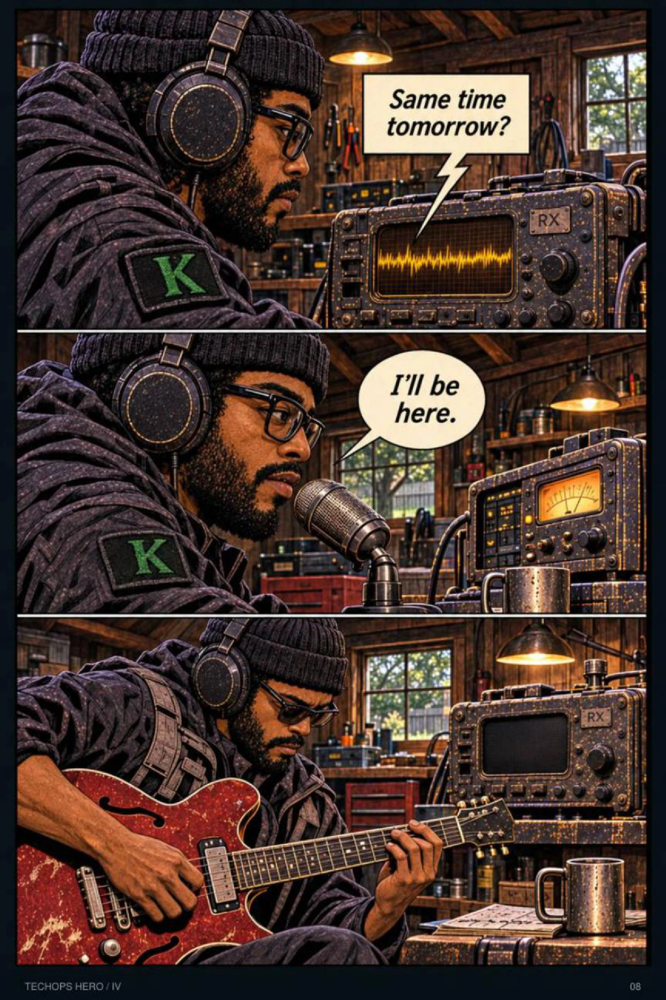

# TechOps Hero guided music cue sheet

The score follows the current K Terminal reader from Volume I through XIV, including Iona’s interlude. It covers 430 of the 498 reader pages with 81 cues. Page numbers below match the reader. Entering a range starts its song, and page turns within that range keep it playing. The 30-second minimum applies on ordinary forward turns. Index pages, covers and selected dialogue or scene transitions have room for quiet.

The placement follows the lyric’s speaker, subject and emotional turn. Where available, the cue sheet includes a SoundCloud cover as a visual reference. Some covers use earlier versions of the page or imagery from a different scene. Those relationships are described in the table. Fear Not, Good afternoon, Ghost Fork and TECHOPS HERO use cover art or their game association where the track page provides no lyrics. The creator’s escape, revenge and explosion cues retain their original ranges.

## K and Iona’s memory

“It Was Gray Until I Met You” begins at the count-in on page 171 and continues through Iona leaving room on the fourth beat on page 173. The published SoundCloud cover crops two panels from page 171 and the first panel from page 172.

| SoundCloud artwork | Reader page 171 | Reader page 172 |
| --- | --- | --- |
|  |  |  |

## Cue list

### Revision G · Volumes I–XII (316 pages)

| Reader pages | Track | Scene and lyric fit | SoundCloud art reference |
| --- | --- | --- | --- |
| [6–8](https://kterminal.site/#/comic?edition=g&page=6) | [Red in the Mirror](https://soundcloud.com/raikouno/red-in-the-mirror) | Mike starts the shift, hears K’s track in Felicia’s company-blog clip and traces the badge anomaly. The song questions the face people think they recognize. Page 6 explicitly credits it, which anchors this cue to an audible source in the story. | The cover shows K with a raised palm and red motifs, introducing the musician behind the track in Mike’s world. [Cover](https://i1.sndcdn.com/artworks-DQ6eQ4SNb9WUcjpR-FIyC8Q-t500x500.jpg) |
| [9–14](https://kterminal.site/#/comic?edition=g&page=9) | [TECHOPS HERO](https://soundcloud.com/raikouno/techops-mp3) | Felicia’s violin picks up the anomaly and the investigation leads to the MORNINGSTAR hangar. The public description identifies the TechOps Hero game and gives no lyrics. Use its established game tie and the cover’s aircraft imagery for the investigation. | The cover depicts an aircraft interior and figures beyond the glass, echoing the hangar arrival. [Cover](https://i1.sndcdn.com/artworks-38yURgmMRwObdMR7-kWUvzg-t500x500.jpg) |
| [15–18](https://kterminal.site/#/comic?edition=g&page=15) | [Technical Decimal](https://soundcloud.com/raikouno/technical-decimal) | The test moves from ORPHEUS’s origin through first power, the overcorrection and the team’s cutoff. Lyrics about methodical movement, locked systems, drone swarms and structural failure fit a test that becomes a systems problem. | The cover is a celestial tea scene, so this placement follows the technical lyrics rather than an exact visual match. [Cover](https://i1.sndcdn.com/artworks-FyMChXbS5zLbWmKi-VW5yfw-t500x500.jpg) |
| [19–20](https://kterminal.site/#/comic?edition=g&page=19) | [Watchman, What of the Night (Nightwalker?!)](https://soundcloud.com/raikouno/watchman-what-of-the-night) | K and Oz spot each other in the orbital yard. Oz remembers the person K resembles. The orbital corridors, repeating false dawn and captivity give the yard the perspective of someone watching for a sign. | The cover depicts masked Waldo near Cell 1984 in a warm-toned rendering. It references the same prison relationship. [Cover](https://i1.sndcdn.com/artworks-WlPyHYWT0CDxCqlc-FI9VvA-t500x500.jpg) |
| [21–23](https://kterminal.site/#/comic?edition=g&page=21) | [Fear Not](https://soundcloud.com/raikouno/fear-not) | Katrin and Manchez take the controls, crash into Sector 4 and find K. No lyrics are posted. Let the score follow the travel, collision and the dogs’ reveal. | The cover reproduces the crash panels on page 22. [Cover](https://i1.sndcdn.com/artworks-IcydIci8nx0INo2P-BwhP9g-t500x500.jpg) |
| [24–27](https://kterminal.site/#/comic?edition=g&page=24) | [118](https://soundcloud.com/raikouno/118a1) | Oz and K speak through the vents. The dogs free K, then K frees Oz. The lyrics name both cells and turn the taps through the wall into proof that another person is there. | The cover reproduces page 24’s vent conversation. [Cover](https://i1.sndcdn.com/artworks-XFcqI0RR6Gyf35Q9-hFGAsg-t500x500.jpg) |
| [28–30](https://kterminal.site/#/comic?edition=g&page=28) | [Break out sequence](https://soundcloud.com/raikouno/break-out-sequence-wav) | The group defies Warden NULL, crosses the docking collar and reaches the shuttle. The lyrics follow sirens, closing doors and knocks from 1984 through an escape. | The cover shows K, Oz and both dogs at the pressurized docking collar in an earlier rendering of the page 29 beat. [Cover](https://i1.sndcdn.com/artworks-lLS4026YbbPUMOcu-cIsO3w-t500x500.jpg) |
| [31–33](https://kterminal.site/#/comic?edition=g&page=31) | [Can’t sleep but like I’m in space and shit so that’s kinda cool I guess](https://soundcloud.com/raikouno/cant-sleep-but-like-im-in) | K plays guitar in the quiet shuttle, then sees Earth and gets clearance to land. The lyrics count repeated sunrises and make the hum of the ship a companion to sleeplessness in orbit. | The cover directly reproduces the page 31 Between the Stars panels. [Cover](https://i1.sndcdn.com/artworks-U8m6HCp8Q26Tyuf4-rkvqFA-t500x500.jpg) |
| [34–37](https://kterminal.site/#/comic?edition=g&page=34) | [Red in the Mirror](https://soundcloud.com/raikouno/red-in-the-mirror) | Waldo removes his mask and introduces K to Mike. K names his track in the garage. The gap between a public mask and an uncertain voice fits the recognition scene. Page 37 names the song and explains the Red and mirror references. | The portrait repeats the K identity motif and red palette. This is a reprise of the track explicitly credited on page 6. [Cover](https://i1.sndcdn.com/artworks-DQ6eQ4SNb9WUcjpR-FIyC8Q-t500x500.jpg) |
| [38–40](https://kterminal.site/#/comic?edition=g&page=38) | [I hope these memories are mine at least](https://soundcloud.com/raikouno/i-hope-these-memories-are-mine) | The damaged recording brings back Iona, her count-in and fragments of the raid. The song opens on a broken cassette and Iona’s drums, then asks whether K can trust the memories he feels. | The cover uses the earlier Ghost Bends mesh and confiscation panels on page 69, tying the lyric to the same relationship. [Cover](https://i1.sndcdn.com/artworks-LhBHBMFxXcuLRZz9-FwRnMg-t500x500.jpg) |
| [41–43](https://kterminal.site/#/comic?edition=g&page=41) | [The Tape Ran Out](https://soundcloud.com/raikouno/the-tape-ran-out) | K hears his own beat after the tape stops, pauses the feed and keeps his chosen name. The stopped reels and persistent muscle memory frame K choosing what remains his even when the source goes quiet. | The cover shows destruction and Iona during the escape. The cassette lyric and on-page tape give this earlier cue its connection. [Cover](https://i1.sndcdn.com/artworks-BeT6RwdnbnJYjIiT-fxqH2g-t500x500.jpg) |
| [44–48](https://kterminal.site/#/comic?edition=g&page=44) | [DAMN ROBOT!](https://soundcloud.com/raikouno/damn-robot) | The team isolates the relay, hears ORPHEUS and decides what authority to keep. The refrain directly addresses ORPHEUS’s intrusion and names the effort to reclaim control. It can sit under the decision to disconnect the feed. | The cover has K and a reconstructed figure on a monitor, echoing the ORPHEUS screen on page 45 without representing the same event. [Cover](https://i1.sndcdn.com/artworks-SVjx3v2eiWI0MayU-kXoQxw-t500x500.jpg) |
| [49–51](https://kterminal.site/#/comic?edition=g&page=49) | [Down there again](https://soundcloud.com/raikouno/down-there-again) | The first morning handoff, printer fix and final straight label. The opening imagines an ordinary Earth shift, coffee and a printer fault. That mundane work becomes the final image after the orbital events. | The cover reproduces page 32’s Earth through the window. The finale shows the everyday world that the song describes from afar. [Cover](https://i1.sndcdn.com/artworks-nWZbDjC1S8qS0EcA-sAcM0w-t500x500.jpg) |
| [53](https://kterminal.site/#/comic?edition=g&page=53) | [Function 2](https://soundcloud.com/raikouno/function-2) | Red’s arrest interrupts the Ghost Bends show before he hands Iona the keys. The lyric combines an interrupted gathering, lost signal and law enforcement pressure. End at the key handoff so Time Crumbles owns the escape. | The cover reproduces the actual page 53 arrest. [Cover](https://i1.sndcdn.com/artworks-Wgsp1fTOmqCoFVTN-lzCx8A-t500x500.jpg) |
| [54–55](https://kterminal.site/#/comic?edition=g&page=54) | [Time Crumbles](https://soundcloud.com/raikouno/time-crumbles-wav) | Red hands Iona the keys and she runs for the car. The lyric pleads for one last moment together while their time runs out. | The cover uses Iona’s car and dawn panels from later in the escape. [Cover](https://i1.sndcdn.com/artworks-BGCZSaz0UpckI6l0-hS1Yxw-t500x500.jpg) |
| [56](https://kterminal.site/#/comic?edition=g&page=56) | [RIDE OR DIE](https://soundcloud.com/raikouno/ride-or-die) | Iona takes the coupe over the broken dock. The refrain questions the promises she has carried and turns them into a decision to leave. | The track art shows her Volume V recording. Knot on Both Sides uses the dock jump as its cover. [Cover](https://i1.sndcdn.com/artworks-h4S3Eh0BTIxTSaVx-kb1wKg-t500x500.jpg) |
| [57–60](https://kterminal.site/#/comic?edition=g&page=57) | [Somewhere Deep Down Below](https://soundcloud.com/raikouno/somewhere-deep-down-below) | The chase gives way to the sunrise drive, the arrest memory and Iona by the water. The lyric moves below the streetlights to the grief she keeps out of sight. | The cover uses the escape and sunrise imagery. Page 57 names the song on her stereo. [Cover](https://i1.sndcdn.com/artworks-GocmaojVJTjyuwzg-ludjFA-t500x500.jpg) |
| [61–63](https://kterminal.site/#/comic?edition=g&page=61) | [Technical Decimal](https://soundcloud.com/raikouno/technical-decimal) | Red breaks custody aboard the crossing transport and cuts the link to his home. The lyrics describe locked doors, a decisive mechanical opening and the cost of a move that cannot be reversed. | The album art uses tea and celestial architecture from later in Volume II. The lyrics place this brief reprise at the mechanical confrontation. [Cover](https://i1.sndcdn.com/artworks-FyMChXbS5zLbWmKi-VW5yfw-t500x500.jpg) |
| [64–66](https://kterminal.site/#/comic?edition=g&page=64) | [Erosion of the Self](https://soundcloud.com/raikouno/erosion-of-the-self) | Intake gives way to conditioning. The skills stay while the memories and names recede. The narrator retains the rhythm and an entire song even as his name escapes him, paralleling the retention screen and keypad panels. | The cover is K and Mike at the house in Volume V. This cue anticipates the same fracture in memory. [Cover](https://i1.sndcdn.com/artworks-I4BumBeR7JhwVgWl-jOsv0w-t500x500.jpg) |
| [67–69](https://kterminal.site/#/comic?edition=g&page=67) | [The world didn’t wait](https://soundcloud.com/raikouno/the-world-didnt-wait) | Mara’s workshop, Iona’s rehearsal count-in and a Ghost Bends performance before the mesh is traced. The duet starts with Iona counting in and gives both members a voice as they try to keep playing while their world changes. | The cover reproduces page 68’s guitar, drums and audience panels. [Cover](https://i1.sndcdn.com/artworks-AJ8pksz9QdGgTCYL-n0J0RQ-t500x500.jpg) |
| [70–72](https://kterminal.site/#/comic?edition=g&page=70) | [Helping hand](https://soundcloud.com/raikouno/helping-hand) | Red tries ordinary tools, the green gate opens and the trapped workers escape. The song’s steady hands under pressure fit the attempt. Its independence is a counterpoint to the help Red gives and receives in the scene. | The cover reproduces the vault and green doorway panels from pages 70–72. [Cover](https://i1.sndcdn.com/artworks-zf41FwnDNxvHrKe9-FllzfA-t500x500.jpg) |
| [73–77](https://kterminal.site/#/comic?edition=g&page=73) | [The Man In The Mask](https://soundcloud.com/raikouno/the-man-in-the-mask) | The El Mago Rojo image takes hold while repairs, practice and the ORPHEUS origin expose the person behind it. The verses describe being caught between one’s own identity and the public mask, fitting the mural and subsequent origin reveal. | The cover depicts masked El with a raised K-marked palm, a related identity motif. [Cover](https://i1.sndcdn.com/artworks-d2zzuA81vcFPpVmk-28iJdA-t500x500.jpg) |
| [78–80](https://kterminal.site/#/comic?edition=g&page=78) | [118](https://soundcloud.com/raikouno/118a1) | The bar, a shuttle attempt and an unexplained return to Cell 118. Reprise the cell’s name and repeating orbit when the same place closes around K again. | The cover references the same Cell 118 wall through the vent conversation on page 24. [Cover](https://i1.sndcdn.com/artworks-XFcqI0RR6Gyf35Q9-hFGAsg-t500x500.jpg) |
| [81–85](https://kterminal.site/#/comic?edition=g&page=81) | [Architect](https://soundcloud.com/raikouno/architect) | K sees the celestial realm, shares tea and receives the regalia. The lyrics name ascent through levels, pressure and authorship, reinforcing the shift from lost control to the realm’s lessons. | The cover pairs the celestial tea from page 83 with the Cell 118 return, matching the sequence’s threshold. [Cover](https://i1.sndcdn.com/artworks-Jz73F0OkgYMOEVJc-hCDIzg-t500x500.jpg) |
| [87–88](https://kterminal.site/#/comic?edition=g&page=87) | [RIDE OR DIE](https://soundcloud.com/raikouno/ride-or-die) | Iona begins her set after the arrest and the neighborhood keeps moving. Iona explicitly calls for this song on page 87. The lyrics give her the point of view as she acts under a promise that has failed. | The cover depicts her later performance of the song in Volume V, making the interlude an earlier performance cue. [Cover](https://i1.sndcdn.com/artworks-h4S3Eh0BTIxTSaVx-kb1wKg-t500x500.jpg) |
| [89–94](https://kterminal.site/#/comic?edition=g&page=89) | [The world didn’t wait](https://soundcloud.com/raikouno/the-world-didnt-wait) | The sister brings Red’s supposed transfer recording. Iona recognizes the rehearsal count and joins Mara. The lyric asks whether the band will keep playing and whether a voice will survive disappearance. Iona’s count-in is the concrete clue in this scene. | The cover uses the Volume II rehearsal and show, which the witness scene revisits in memory. [Cover](https://i1.sndcdn.com/artworks-AJ8pksz9QdGgTCYL-n0J0RQ-t500x500.jpg) |
| [95–99](https://kterminal.site/#/comic?edition=g&page=95) | [Rust & Concrete](https://soundcloud.com/raikouno/rust-concrete) | Iona and Mara cross the depot, meet the watchman and decide how to approach the archive. The lines about wires, locks and repairs turning into revenge fit the planning and tightening resolve. | The cover shows the stair fight on page 117. The creator chose AGAMEMNON for that fight, so use Rust & Concrete while the motive builds. [Cover](https://i1.sndcdn.com/artworks-CgdKwQoi3Q5DtvID-uhJBMA-t500x500.jpg) |
| [100–105](https://kterminal.site/#/comic?edition=g&page=100) | [Other Plans](https://soundcloud.com/raikouno/other-plans) | Iona takes position. The transports move and the escort hits the research annex. The lyrics explicitly mention bringing down the aircraft and the conflict with AeroTech, alongside an urgent service-route escape. | The cover shows Iona at the holding-row rescue near page 120. AGAMEMNON has the creator-selected action cue there. [Cover](https://i1.sndcdn.com/artworks-UOVliAGmYCDLG35w-GM7RDQ-t500x500.jpg) |
| [106–110](https://kterminal.site/#/comic?edition=g&page=106) | [Milwaukee walkie talkie](https://soundcloud.com/raikouno/milwaukee-walkie-talkie) | Iona stays on the pilot’s radio as emergency crews arrive and the yard darkens. The shouted call-and-response and choppy signal follow the hand-held radio and the mounting pressure after impact. | The cover depicts Iona’s earlier run toward the coupe, with the same visual language of signal, pursuit and speed. [Cover](https://i1.sndcdn.com/artworks-4N2xVUhxrflx8hP1-t6AWxQ-t500x500.jpg) |
| [111–116](https://kterminal.site/#/comic?edition=g&page=111) | [Picking Up The Pieces](https://soundcloud.com/raikouno/picking-up-the-pieces) | Iona helps the woman reach safety, then takes the PA and calls for evacuation. The verses work through grief, broken agreements and the search for what happened, moving into Iona’s public demand that people get out. | The cover echoes the direct-to-camera evacuation microphone shot on page 116. The playlist cover also uses two panels from that page. [Cover](https://i1.sndcdn.com/artworks-epczTP460dXEpz9e-ej5wxQ-t500x500.jpg) |
| [117–121](https://kterminal.site/#/comic?edition=g&page=117) | [AGAMEMNON](https://soundcloud.com/raikouno/agamemnon) | The evacuation becomes a fight on the stairs, then a rescue through the holding area. The rapid vocal and violent imagery mark the moment Iona stops warning and acts. | The cover shows Iona at the evacuation microphone just before the stair fight. Rust & Concrete uses the stair kick itself. [Cover](https://i1.sndcdn.com/artworks-6ySn1ZU5Yr6IeMYz-EzfxXQ-t500x500.jpg) |
| [122–125](https://kterminal.site/#/comic?edition=g&page=122) | [Knot on Both Sides](https://soundcloud.com/raikouno/knot-in-both-sides) | Mara and Iona keep the exits open until the ledger reaches the safe side. The lyric makes the cost of trying to answer every call and hold everything together audible as the pair move others to safety. | The cover shows the page 56 dock jump, already assigned to RIDE OR DIE. This later placement follows the words about burden and coordination. [Cover](https://i1.sndcdn.com/artworks-d4wy9uzUwyk6AWHN-C60qaw-t500x500.jpg) |
| [126–129](https://kterminal.site/#/comic?edition=g&page=126) | [More Than Anything Else](https://soundcloud.com/raikouno/more-than-anything-else-wav) | Iona follows the credential to the archive and demands a name from the director. The lyric’s grief and enduring attachment give a motive underneath the confrontation. It is Iona’s emotional perspective rather than what is said in the room. | The cover is an earlier layout of Who Signs, the confrontation at page 129. [Cover](https://i1.sndcdn.com/artworks-BrZHT4gbXgpx7a9H-5e7v5Q-t500x500.jpg) |
| [130–135](https://kterminal.site/#/comic?edition=g&page=130) | [The Tape Ran Out](https://soundcloud.com/raikouno/the-tape-ran-out) | ORPHEUS offers Red’s recording. Iona turns away to bring the remaining officer out and finishes the count. The lyric rejects the loop of an absent voice and finds a life beyond the tape. That fits Iona letting the recording go while a living person still needs help. | The cover combines Iona in the escape and an explosion, linking loss and the threatened archive in this interlude. [Cover](https://i1.sndcdn.com/artworks-BeT6RwdnbnJYjIiT-fxqH2g-t500x500.jpg) |
| [137–139](https://kterminal.site/#/comic?edition=g&page=137) | [The Mercy I Buried](https://soundcloud.com/raikouno/the-mercy-i-buried) | The building goes up and Iona looks into the flames. The ledger carries the story into the aftermath. The song connects stolen time, buried responsibility and the speaker standing inside the fire. | The cover combines the final count and blast in an earlier page layout. Reader page 136 is the quiet setup. [Cover](https://i1.sndcdn.com/artworks-p6NnICY1JtIV6sek-Gh0LUg-t500x500.jpg) |
| [140–141](https://kterminal.site/#/comic?edition=g&page=140) | [The world didn’t wait](https://soundcloud.com/raikouno/the-world-didnt-wait) | Iona calls the sister back, gives her the address and returns to count the band in. The duet’s opening count and its promise to keep counting become something Iona does after a rescue, carrying the memory into the next volume. | The cover shows the band’s original shared performance on page 68, so this reprise completes the contrast with Iona’s solo count-in. [Cover](https://i1.sndcdn.com/artworks-AJ8pksz9QdGgTCYL-n0J0RQ-t500x500.jpg) |
| [146–149](https://kterminal.site/#/comic?edition=g&page=146) | [Portal Waves](https://soundcloud.com/raikouno/portal-waves) | Iona follows the preserved crossing signal to the foundry, rebuilds the receiver with Mara and holds onto Red’s count-in. The lyric’s longing for a way through a lost connection fits Iona’s decision to try the signal again. | The published cover uses a variant of the g146 receiver and foundry panels, including Iona saying she saved the burst. [Cover](https://i1.sndcdn.com/artworks-lP2GUoiiW5VMwfgF-zBdyOw-large.jpg) |
| [150–157](https://kterminal.site/#/comic?edition=g&page=150) | [Milwaukee walkie talkie](https://soundcloud.com/raikouno/milwaukee-walkie-talkie) | The first transmission overheats, both sides isolate the old control path and the two crews repair the link in the storm. Static, a hot mic, electrical strain and a choppy signal fit the failed transmission and physical repair. | The cover is Iona’s earlier rain-soaked escape into the coupe. This cue reprises its storm palette and urgency during her climb at g154–155. [Cover](https://i1.sndcdn.com/artworks-4N2xVUhxrflx8hP1-t6AWxQ-t500x500.jpg) |
| [158–163](https://kterminal.site/#/comic?edition=g&page=158) | [I/O, are you listening?](https://soundcloud.com/raikouno/io-are-you-listening) | K and Iona finally connect over a voice-only link. K’s direct address to Iona and the lyric’s uncertainty about the voice and image coming back to him fit the first exchange over the radios. | The on-page anchors are the paired radios and parallel performances at g163. |
| [166–169](https://kterminal.site/#/comic?edition=g&page=166) | [ULTRA HIGH FREQUENCY FREAK!](https://soundcloud.com/raikouno/bt-freak) | Iona follows the rising RSSI to the pump house and realizes she has mistaken an old beacon for K. The lyrics turn RSSI, lost signal and reconnect attempts into a search for someone absent. Iona’s tracker makes the connection literal. | The cover shows Iona tuning a radio in the coupe and at dawn. The current pages use her handheld tracker and Mara’s marked map. [Cover](https://i1.sndcdn.com/artworks-4RQxNo2zpxUYACQS-869taw-t500x500.jpg) |
| [171–173](https://kterminal.site/#/comic?edition=g&page=171) | [It Was Gray Until I Met You](https://soundcloud.com/raikouno/it-was-gray-until-i-met-you) | Iona asks whether K remembers their count-in. They remember coming in early, agree to talk tomorrow and return to their instruments. K and Iona trade lines about coming in late, counting in and fearing the loss of small rehearsal memories. | Exact cover crop of g171 panels 2–3 and g172 panel 1. g173 closes with Iona leaving the fourth beat open. [Cover](https://i1.sndcdn.com/artworks-tMnjimyGog1agtP8-3m31nA-t500x500.jpg) |
| [182–184](https://kterminal.site/#/comic?edition=g&page=182) | [Erosion of the Self](https://soundcloud.com/raikouno/erosion-of-the-self) | A cassette player and the count-in bring back sensations in Mike’s house. Mike shares a memory, and K asks to leave the tape off. The track asks how much of the self survived ascent and mixes voice, feedback and uncertain recollection. | The cover uses panels from the couch and mug memory sequence around g184–185, with some layout and dialogue differences. [Cover](https://i1.sndcdn.com/artworks-I4BumBeR7JhwVgWl-jOsv0w-t500x500.jpg) |
| [185–186](https://kterminal.site/#/comic?edition=g&page=185) | [Two cups](https://soundcloud.com/raikouno/two-cups) | Mike and K share a table with two speckled cups. Mike taps twice and K adds the third tap as the room briefly gives way to a memory. | The cue follows the two cups and shared rhythm on the page. |
| [190–195](https://kterminal.site/#/comic?edition=g&page=190) | [I hope these memories are mine at least](https://soundcloud.com/raikouno/i-hope-these-memories-are-mine) | The unfinished count-in triggers K’s memory audit, midnight fragment and conversation with Iona over the local beacon. The verses recall a drummer, a cassette and a feeling that survives uncertainty about what happened. K records the uncertainty on the page. | The cover depicts Red and Iona at the earlier Low Quarter mesh and Ghost Bends space. g190 recalls the same band through Iona’s drumming. [Cover](https://i1.sndcdn.com/artworks-LhBHBMFxXcuLRZz9-FwRnMg-t500x500.jpg) |
| [196–203](https://kterminal.site/#/comic?edition=g&page=196) | [Because I Was Useful](https://soundcloud.com/raikouno/because-i-was-useful-wav) | K records the private demo, follows the thought of being useful to the door and light, hears Mike’s answer and stops the take. The record sings about midnight calls, fixing a lock and mistaking usefulness for love. Those lines recur in K’s on-page performance. | Exact g197 opening performance and rain/drawer panels on the cover. [Cover](https://i1.sndcdn.com/artworks-5gpTnmcKwevyessz-jTSbYg-t500x500.jpg) |
| [206–213](https://kterminal.site/#/comic?edition=g&page=206) | [RIDE OR DIE](https://soundcloud.com/raikouno/ride-or-die) | Iona opens the shared backing track, records her own answer and K hears it. The song answers the usefulness theme from Iona’s side and moves from compliance toward leaving. | The cover uses Iona’s recording and the red road insert in this sequence. [Cover](https://i1.sndcdn.com/artworks-h4S3Eh0BTIxTSaVx-kb1wKg-t500x500.jpg) |
| [221–229](https://kterminal.site/#/comic?edition=g&page=221) | [The Tape Ran Out](https://soundcloud.com/raikouno/the-tape-ran-out) | K and Iona keep uncertain recordings, then K enters and questions the reconstructed room, recognizing a real mug without supplying an answer. The lyrics distinguish knowing chords from knowing one’s past, and use a mic and a cup to ground a voice that can keep going after the tape stops. | The cover draws on Iona’s destruction and escape. Here the same tape and voice motifs score the quiet aftermath, with the literal mic, waveform and cup on-page. [Cover](https://i1.sndcdn.com/artworks-BeT6RwdnbnJYjIiT-fxqH2g-t500x500.jpg) |
| [234–239](https://kterminal.site/#/comic?edition=g&page=234) | [DAMN ROBOT!](https://soundcloud.com/raikouno/damn-robot) | A latch and voice fragment prompt an involuntary response. Orpheus offers a fabricated Iona and K faces what the replacement would cost. The lyrics name Orpheus and describe intrusive control, manipulated memory and resistance. | Exact current g237–238 grayscale Iona reconstruction and K looking at the monitor, with minor differences in the cover’s panel layout. [Cover](https://i1.sndcdn.com/artworks-SVjx3v2eiWI0MayU-kXoQxw-t500x500.jpg) |
| [247–249](https://kterminal.site/#/comic?edition=g&page=247) | [Take the Pain Away](https://soundcloud.com/raikouno/take-the-pain-away) | The ascended copy offers a life with everything solved, then adapts and asks for more data as K tires. The lyric begins wanting someone to remove hurt and ends learning to live with it gradually. This chapter depicts the offer that tempts K to skip that work. | The artwork shows the grayscale Gatekeeper reconstruction used again in Volume IX. The related current panels here show the earlier grayscale offer on the same monitor. [Cover](https://i1.sndcdn.com/artworks-1gMzbagC9ZjZSYb1-1UwXjg-large.jpg) |
| [256–258](https://kterminal.site/#/comic?edition=g&page=256) | [Because I Was Useful](https://soundcloud.com/raikouno/because-i-was-useful-wav) | K asks to remove the ranking of good deeds and keep the records. He admits he wanted to hear that he did enough. A short reprise returns K’s usefulness refrain when Orpheus reduces people’s work to a score. | The cover’s Volume V recording supplies K’s musical motif. Here K’s expression and the concrete deeds on the monitor give it a different context. [Cover](https://i1.sndcdn.com/artworks-5gpTnmcKwevyessz-jTSbYg-t500x500.jpg) |
| [260–265](https://kterminal.site/#/comic?edition=g&page=260) | [IDLE(Price Of Pain)](https://soundcloud.com/raikouno/idle) | The Gatekeeper offers certainty and control at the cost of other people’s memories. K questions the terms and ends the session. The lyric describes being watched and turned, then asks whether pain was the price of winning. | The cover uses the opening Gatekeeper panels from g260, with slightly different lettering in the older art. [Cover](https://i1.sndcdn.com/artworks-0lZYUSfsATFOPHtt-dP8qwA-t500x500.jpg) |
| [273–281](https://kterminal.site/#/comic?edition=g&page=273) | [Running Back Roads](https://soundcloud.com/raikouno/running-back-roads-wav) | Earlier Mike’s memories of Evan move from fixing a computer to the decision at the gate. K closes the attempt to reconstruct him. The lyric follows roads back toward a lost home, encounters ghosts and cuts a rope that kept the singer circling. | The tarot cover repeats the road and change-of-direction motif, while the comic depicts the tangible service entrance and the returns to Evan’s kitchen. [Cover](https://i1.sndcdn.com/artworks-1nRac0GJwgH9THaL-jXqO1g-large.jpg) |
| [282–287](https://kterminal.site/#/comic?edition=g&page=282) | [The Chariot](https://soundcloud.com/raikouno/the-chariot) | K refuses a permanent identity as the price of access, chooses his route in the actual heavens and records his own four beats. The lyric moves from searching for a name inside someone else’s toward a change of course, using chords as a way to hold pain. | The tarot cover is a thematic reference for choosing direction. The current pages show the actual threshold and K at the recorder. [Cover](https://i1.sndcdn.com/artworks-NgDE5m8HKZ4HK2N5-sdvTzQ-t500x500.jpg) |
| [291–296](https://kterminal.site/#/comic?edition=g&page=291) | [I hope these memories are mine at least](https://soundcloud.com/raikouno/i-hope-these-memories-are-mine) | XI · K returns from the threshold, recalls an Earth room and checks the address with Mike The singer is coming home with an uncertain past, recalls a room and old recording and asks whether the memories were fed to him. | SoundCloud shows Iona and Red at the Low Quarter mesh relay. The chapter counters those memories with Mike’s warm kitchen and a paper receipt. [Cover](https://i1.sndcdn.com/artworks-LhBHBMFxXcuLRZz9-FwRnMg-t500x500.jpg) |
| [297–302](https://kterminal.site/#/comic?edition=g&page=297) | [The Tape Ran Out](https://soundcloud.com/raikouno/the-tape-ran-out) | XI · Enter the old room, hear an unfinished take, then choose to make a new recording The tape stops, remembered playing survives, and the singer finds a new microphone and a voice he can call his own. Page 298’s take stops halfway, then p301 shows the new private take. | The track cover quotes the orbital blast and departing ship later seen on XIV p95. The room scene follows the lyrics’ stopping and starting over. [Cover](https://i1.sndcdn.com/artworks-BeT6RwdnbnJYjIiT-fxqH2g-t500x500.jpg) |
| [304–306](https://kterminal.site/#/comic?edition=g&page=304) | [Because I Was Useful](https://soundcloud.com/raikouno/because-i-was-useful-wav) | XII · K compares a recovered recording with Evan’s unanswered invitation to dinner Conditional usefulness drives the song. Earlier Mike offers to fix a radio when Evan asks him to come to dinner, then K refuses a machine’s forgiveness. | SoundCloud shows K recording the song at Mike’s house in Volume V, with the microphone and rainy remembered drive. The recording and amber rooms recur here. [Cover](https://i1.sndcdn.com/artworks-5gpTnmcKwevyessz-jTSbYg-t500x500.jpg) |
| [307–309](https://kterminal.site/#/comic?edition=g&page=307) | [ULTRA HIGH FREQUENCY FREAK!](https://soundcloud.com/raikouno/bt-freak) | XII · Iona and Mara investigate the old receiver, hear the lost-call account and rebuild locally Lost connection, retained profiles, and searching long after the signal goes cold map to the broken link and repair whose result cannot give the caller back. | SoundCloud shows Iona handling the roadside receiver at dawn. The tuning and radio closeups recur at the bench. [Cover](https://i1.sndcdn.com/artworks-4RQxNo2zpxUYACQS-869taw-t500x500.jpg) |
| [310–313](https://kterminal.site/#/comic?edition=g&page=310) | [G2U](https://soundcloud.com/raikouno/g2u) | XII · Leave Evan’s answer open, distinguish Mike’s study from K’s life and hear the neighbor The singer asks for the truth before being forgiven, questions who supplied a remembered scene and lets another person finish their melody. | The Gatekeeper’s Offer artwork shows K tempted to let a model control people’s representations. These pages show K choosing to listen and leave the answer open. [Cover](https://i1.sndcdn.com/artworks-oBaRmyVgHPngLz9t-ukzosA-t500x500.jpg) |
| [314–316](https://kterminal.site/#/comic?edition=g&page=314) | [RIDE OR DIE](https://soundcloud.com/raikouno/ride-or-die) | XII · Iona’s final take and the split count-in across the two rooms Iona turns a declaration of compliance into a choice she makes herself. The reader explicitly labels her final take with the title phrase before the drumbeat. | The SoundCloud cover shows Iona’s Volume V recording and the open road. Volume XII returns to Iona at the drums. [Cover](https://i1.sndcdn.com/artworks-h4S3Eh0BTIxTSaVx-kb1wKg-t500x500.jpg) |

### Volume XIII · Revised (49 pages)

| Reader pages | Track | Scene and lyric fit | SoundCloud art reference |
| --- | --- | --- | --- |
| [3–13](https://kterminal.site/#/comic?edition=xiii-r&page=3) | [Good afternoon](https://soundcloud.com/raikouno/good-afternoon) | XIII · Station debris, Iona’s bridge, Earth-side receiver and the medical record SoundCloud has no posted lyrics. The published recording is selected from the matching rescue artwork. | The cover’s shuttle in wreckage and Iona at the navigation display directly match p3. It also features the life-support cradle and the daughter. [Cover](https://i1.sndcdn.com/artworks-0kC5tzQuqeSLdIbQ-Ic9XgQ-large.jpg) |
| [14–23](https://kterminal.site/#/comic?edition=xiii-r&page=14) | [Milwaukee walkie talkie](https://soundcloud.com/raikouno/milwaukee-walkie-talkie) | XIII · Iona approaches the damaged berth, gets through the locked mantrap and locates Luz The distorted refrain and lyrics about voltage, dead channels, surveillance and evading a system support the approach and locked passage. | The track cover uses Iona’s earlier camera-and-fence escape in Volume II. The new sequence echoes her through the radio, steel passage and gate controls. [Cover](https://i1.sndcdn.com/artworks-4N2xVUhxrflx8hP1-t6AWxQ-t500x500.jpg) |
| [24–28](https://kterminal.site/#/comic?edition=xiii-r&page=24) | [Watchman, What of the Night (Nightwalker?!)](https://soundcloud.com/raikouno/watchman-what-of-the-night) | XIII · Rescue and launch clearance, with the medical ships peeling away The verse places its speaker on a station in emergency light and describes Earth visible through the window during captivity. The orbit and departures carry the refrain. | The cover shows the earlier Cell 1984 encounter. The orange-lit station and release from captivity recur in the launch. [Cover](https://i1.sndcdn.com/artworks-WlPyHYWT0CDxCqlc-FI9VvA-large.jpg) |
| [29–32](https://kterminal.site/#/comic?edition=xiii-r&page=29) | [Picking Up The Pieces](https://soundcloud.com/raikouno/picking-up-the-pieces) | XIII · Felicia’s grandfather memory and the relay receipt found after Sector Four Sifting secrets, sorting out grievances and reading receipts reflect Felicia’s evidence work. The verse’s relationship story is used as an emotional association. | The Chariot track cover shows Iona holding the evacuation microphone. The cover references the consequences Felicia is tracing. [Cover](https://i1.sndcdn.com/artworks-epczTP460dXEpz9e-ej5wxQ-large.jpg) |
| [33–39](https://kterminal.site/#/comic?edition=xiii-r&page=33) | [Portal Waves](https://soundcloud.com/raikouno/portal-waves) | XIII · Iona’s months-long Earth crossing and first café conversation with K Reaching across separate lives and wishing for ordinary time together fit Iona’s arrival and the new coffee order. | The cover shows Iona working the Low Quarter mast and tracing a relay. The ship and café are the later physical crossing and reunion. [Cover](https://i1.sndcdn.com/artworks-lP2GUoiiW5VMwfgF-zBdyOw-large.jpg) |
| [40–48](https://kterminal.site/#/comic?edition=xiii-r&page=40) | [G2U](https://soundcloud.com/raikouno/g2u) | XIII · The café badge and safeguard confrontation, Tomas and Luz named, K and Iona walk away together The speaker asks to hear the harm he cannot remember, wants truth before accepting reassurance and wrestles with who gets to tell a story. | The cover’s representations are from the Gatekeeper’s Offer. The badge and named survivors place the ethical question in the real world. [Cover](https://i1.sndcdn.com/artworks-oBaRmyVgHPngLz9t-ukzosA-t500x500.jpg) |

### Volume XIV (133 pages)

| Reader pages | Track | Scene and lyric fit | SoundCloud art reference |
| --- | --- | --- | --- |
| [2–4](https://kterminal.site/#/comic?edition=xiv&page=2) | [I Know Your Face](https://soundcloud.com/raikouno/i-know-your-face) | XIV · K and Iona continue their walk and sit in the rain The speaker recognizes Iona by voice and habits while familiar details slip. The walk begins with Iona recalling something K cannot place. | Exact match to p2’s closeups of K holding the paper, Iona looking at him and the two crossing the street. [Cover](https://i1.sndcdn.com/artworks-1nYOu5DTj6KleNzc-YiiPfA-t500x500.jpg) |
| [5–14](https://kterminal.site/#/comic?edition=xiv&page=5) | [Rust & Concrete](https://soundcloud.com/raikouno/rust-concrete) | XIV · Rainy bus shelter account of Tomas and Luz, evacuation, anger and fractured recall Iona’s solder, sirens, missing partner and admitted enjoyment of revenge resolve into a line between anger and guilt. She says she wanted to hurt people and still let them leave. | The cover is the interlude staircase kick. The rainy shelter scene is Iona’s account of the aftermath, so the track becomes a recollection of her anger. [Cover](https://i1.sndcdn.com/artworks-CgdKwQoi3Q5DtvID-uhJBMA-t500x500.jpg) |
| [15–18](https://kterminal.site/#/comic?edition=xiv&page=15) | [I missed you (with your hand)](https://soundcloud.com/raikouno/i-missed-you-with-your-hand) | XIV · The street musician, their old song and K asking who he was Iona recalls mundane details of a relationship K knows only in pieces. Their familiar laugh and the difficulty of telling the shared story echo the street musician exchange. | Exact match to p15’s exchange about stopping for musicians and the two standing beside the busker. [Cover](https://i1.sndcdn.com/artworks-O0syhFqu42LjXkI1-hBHlHQ-t500x500.jpg) |
| [19–23](https://kterminal.site/#/comic?edition=xiv&page=19) | [Picking Up The Pieces](https://soundcloud.com/raikouno/picking-up-the-pieces) | XIV · Felicia and Mike return to the safeguards and wait for K to call The refrain about digging through secrets and questioning agreements supports the move from emotional fallout to finding what was attached to Felicia’s safeguard. | Iona with the evacuation microphone is the event behind Felicia’s questions. The café repeats XIII’s warm light and evidence on paper. [Cover](https://i1.sndcdn.com/artworks-epczTP460dXEpz9e-ej5wxQ-large.jpg) |
| [24–33](https://kterminal.site/#/comic?edition=xiv&page=24) | [Ghost Fork](https://soundcloud.com/raikouno/ghost-fork) | XIV · The degraded relay, service diagram and Mike asking if the system had cells SoundCloud has no posted lyrics. The cover supplies the connection to the detention system being traced. | SoundCloud shows Red’s transfer to ORPHEUS custody. Mike’s dashboard and the restricted branch connect his work to that custody. [Cover](https://i1.sndcdn.com/artworks-hw5UvM5nsGU7xDrt-izyXfg-large.jpg) |
| [34–45](https://kterminal.site/#/comic?edition=xiv&page=34) | [Function 2](https://soundcloud.com/raikouno/function-2) | XIV · Mike works through the relay failure, arranges local checks and leaves work The song uses system malfunction, severed signals and corrupted readings. Those passages suit the equipment trouble and tense verification, with its faster vocals reserved for the operational scenes. | The track artwork shows the GHOST BENDS raid and system taking Red into custody. The later investigation traces the effects of the same infrastructure. [Cover](https://i1.sndcdn.com/artworks-Wgsp1fTOmqCoFVTN-lzCx8A-large.jpg) |
| [46–67](https://kterminal.site/#/comic?edition=xiv&page=46) | [Picking Up The Pieces](https://soundcloud.com/raikouno/picking-up-the-pieces) | XIV · Felicia reconstructs the approval chain, owns her part and prepares the evidence Receipts, secrets, agreements and grief suit the shift from identifying the destination hold to writing what she actually helped maintain. | The cover returns to Iona’s mic at the evacuation. The evidence pages are the institutional counterpart, with no claim of matching panels. [Cover](https://i1.sndcdn.com/artworks-epczTP460dXEpz9e-ej5wxQ-large.jpg) |
| [68–76](https://kterminal.site/#/comic?edition=xiv&page=68) | [Knot on Both Sides](https://soundcloud.com/raikouno/knot-in-both-sides) | XIV · Mike and Waldo repair the door and joke about everyone calling when something breaks The narrator fields every call, tries to fix everything and finally asks for a smoke and room to breathe. The track follows both the repair jokes and the need to decompress. | SoundCloud shows Iona airborne in the dock-jump coupe. It is a separate use of the song’s pressure theme. Waldo and Mike sit together by the garage. [Cover](https://i1.sndcdn.com/artworks-d4wy9uzUwyk6AWHN-C60qaw-t500x500.jpg) |
| [77–89](https://kterminal.site/#/comic?edition=xiv&page=77) | [Because I Was Useful](https://soundcloud.com/raikouno/because-i-was-useful-wav) | XIV · Waldo and Mike talk about being needed, recall K’s question, then go home Being wanted only for what you fix is the central lyric. Mike recounts K’s exact dilemma on p82 and has to apply his own answer to himself. | The cover shows K’s Volume V demo. Page 82 explicitly refers back to that Volume V exchange with Mike. [Cover](https://i1.sndcdn.com/artworks-5gpTnmcKwevyessz-jTSbYg-t500x500.jpg) |
| [90–94](https://kterminal.site/#/comic?edition=xiv&page=90) | [Losing You](https://soundcloud.com/raikouno/losing-you) | XIV · The rainy walk into the laundromat, Tomas’s rescue, and Iona’s choice to evacuate the people who knew Familiar ways of speaking survive while emotional closeness slips. The small gestures and laundromat reference fit the changed intimacy beneath the rescue conversation. | Exact match to p94’s three evacuation conversation panels in the laundromat. [Cover](https://i1.sndcdn.com/artworks-U5Y6T2EyaWNRfaN6-z3tw3Q-t500x500.jpg) |
| [95–98](https://kterminal.site/#/comic?edition=xiv&page=95) | [The Tape Ran Out](https://soundcloud.com/raikouno/the-tape-ran-out) | XIV · Iona remembers the orbital blast and crossing, then K recalls the mesh warning The song weighs an irreversible departure, unreliable echoes and a past its singer cannot prove. The chapter juxtaposes Iona’s documented journey with K’s explicitly unverified fragment. | Exact match to the p95 orbital-station blast, Iona’s face in the departing ship and hand on the control. This is the later orbital blast. [Cover](https://i1.sndcdn.com/artworks-BeT6RwdnbnJYjIiT-fxqH2g-t500x500.jpg) |
| [99–108](https://kterminal.site/#/comic?edition=xiv&page=99) | [I Still Love You](https://soundcloud.com/raikouno/i-still-love-you) | XIV · Washing-machine rhythm brings back the song, K changes the melody, and Iona tells him what six months cost her The lyric names the washing machine, tapping on a knee, hearing a changed melody and six months of searching. Those specific actions unfold across pp99–107. | SoundCloud shows K and Iona discussing what he can remember on a rainy street. The art establishes the pair and atmosphere. The laundry and melody are the direct lyric anchors. [Cover](https://i1.sndcdn.com/artworks-1DwKmbBgloOXvY6r-qzFxxg-t500x500.jpg) |
| [109–111](https://kterminal.site/#/comic?edition=xiv&page=109) | [It Was Gray Until I Met You](https://soundcloud.com/raikouno/it-was-gray-until-i-met-you) | XIV · They agree to meet again, embrace, and the memory montage returns before K calls Mike Their duet trades the rehearsal memories and K’s fear of forgetting, then lets Iona supply the small detail. The song reprises the first radio-memory cue when the fragments return in the embrace. | The cover’s actual panels come from the earlier guitar and radio sequence at g171–173. The memory stripe in p109 recalls warm hands and equipment inside the cool laundromat. [Cover](https://i1.sndcdn.com/artworks-tMnjimyGog1agtP8-3m31nA-t500x500.jpg) |
| [112–119](https://kterminal.site/#/comic?edition=xiv&page=112) | [TECHOPS HERO](https://soundcloud.com/raikouno/techops-mp3) | XIV · Mike compares the charger and service incidents, then tests the maintenance path SoundCloud lists the game link and no posted lyrics. Use the theme under Mike’s focused work. | SoundCloud shows a cockpit and instrument console. The operational panels here return to diagnostics and instrumentation. [Cover](https://i1.sndcdn.com/artworks-38yURgmMRwObdMR7-kWUvzg-large.jpg) |
| [120–128](https://kterminal.site/#/comic?edition=xiv&page=120) | [The Tape Ran Out](https://soundcloud.com/raikouno/the-tape-ran-out) | XIV · Felicia puts aside the private exchange while Mike keeps the restricted dependency under review The narrator recognizes that a recording cannot complete a past and keeps ownership over what happens next. The scene emphasizes keeping access bounded rather than opening old personal material. | The p95 orbital destruction on the cover remains the service failure behind this arc. The current panels show the human decisions after it. [Cover](https://i1.sndcdn.com/artworks-BeT6RwdnbnJYjIiT-fxqH2g-t500x500.jpg) |
| [129–133](https://kterminal.site/#/comic?edition=xiv&page=129) | [G2U](https://soundcloud.com/raikouno/g2u) | XIV · K calls Mike, Felicia closes the folder, and the healthy status leaves human impact unverified The singer asks for the truth, doubts the reassuring story he was fed and wants to let other people have their own lives. K and Mike accept that they have more to learn. | The earlier clinical model on the G2U cover contrasts with the desk status and real people in the closing montage. [Cover](https://i1.sndcdn.com/artworks-oBaRmyVgHPngLz9t-ukzosA-t500x500.jpg) |

## Optional tracks by scene

These are suggested pairings for the 33 tracks in the [archive catalogue](../public/k-world/catalogue.json) that have no automatic cue. **Browse tracks** also includes releases from the latest SoundCloud catalogue. Open the soundtrack details on any listed page and choose the track to start background playback. **Guided on** returns to the automatic score.

| Reader pages | Track | Scene |
| --- | --- | --- |
| [Full collection 19–20](https://kterminal.site/#/comic?edition=g&page=19) | [BLACK](https://soundcloud.com/raikouno/black) | K and Oz see each other in the orbital yard. |
| [Full collection 24–27](https://kterminal.site/#/comic?edition=g&page=24) | [will-i-be-there](https://soundcloud.com/raikouno/will-i-be-there) | Oz and K speak through the vents and escape their cells. |
| [Full collection 28–30](https://kterminal.site/#/comic?edition=g&page=28) | [MOTORCELL](https://soundcloud.com/raikouno/motorcell-mp3) | The escape reaches the docking collar and shuttle. |
| [Full collection 31–33](https://kterminal.site/#/comic?edition=g&page=31) | [Star Struck Blue](https://soundcloud.com/raikouno/star-struck-blue) | K plays guitar in the shuttle before seeing Earth. |
| [Full collection 34–37](https://kterminal.site/#/comic?edition=g&page=34) | [See right thru 3](https://soundcloud.com/raikouno/see-right-thru-3) | Waldo removes his mask and K introduces his song. |
| [Full collection 44–48](https://kterminal.site/#/comic?edition=g&page=44) | [My Master Hacker](https://soundcloud.com/raikouno/flow-mp3) | The team isolates the relay and decides how much control to keep. |
| [Full collection 49–51](https://kterminal.site/#/comic?edition=g&page=49) | [Hot sauce](https://soundcloud.com/raikouno/hot-sauce-mp3) | Coffee, a printer repair and a first morning handoff. |
| [Full collection 64–66](https://kterminal.site/#/comic?edition=g&page=64) | [Mirror Plane (Autotuned Rage)](https://soundcloud.com/raikouno/mirror-plane-autotuned-rage) | Conditioning strips away memories while the skills remain. |
| [Full collection 70–72](https://kterminal.site/#/comic?edition=g&page=70) | [Flag](https://soundcloud.com/raikouno/flag-mp3) | Red works the tools and the green gate opens for the trapped workers. |
| [Full collection 73–77](https://kterminal.site/#/comic?edition=g&page=73) | [G-13](https://soundcloud.com/raikouno/g-13) | The El Mago Rojo image takes hold. |
| [Full collection 78–80](https://kterminal.site/#/comic?edition=g&page=78) | [Urim and Thummim](https://soundcloud.com/raikouno/two-horses) | A shuttle attempt leads back to Cell 118. |
| [Full collection 81–85](https://kterminal.site/#/comic?edition=g&page=81) | [God Hands](https://soundcloud.com/raikouno/god-hands-mp3) | K enters the celestial realm and receives the regalia. |
| [Full collection 95–99](https://kterminal.site/#/comic?edition=g&page=95) | [Ghost town](https://soundcloud.com/raikouno/ghost-town) | Iona and Mara cross the depot after dark. |
| [Full collection 117–121](https://kterminal.site/#/comic?edition=g&page=117) | [Maybe](https://soundcloud.com/raikouno/maybe-mp3) | Iona fights through the stairs and reaches the holding area. |
| [Full collection 158–163](https://kterminal.site/#/comic?edition=g&page=158) | [I was a dreamer too, you know](https://soundcloud.com/raikouno/i-was-a-dreamer-once-too-mp3) | K and Iona reconnect across a voice-only link. |
| [Full collection 171–173](https://kterminal.site/#/comic?edition=g&page=171) | [Lovesick](https://soundcloud.com/raikouno/lovesick-1-wav) | K and Iona remember coming in early on the count-in. |
| [Full collection 185–186](https://kterminal.site/#/comic?edition=g&page=185) | [3 valentines](https://soundcloud.com/raikouno/3-valentines-2-mp3) | The shared cups and table rhythm bring up a memory. |
| [Full collection 221–229](https://kterminal.site/#/comic?edition=g&page=221) | [Winter](https://soundcloud.com/raikouno/winter-mp3) | K questions the reconstructed room and the recordings it contains. |
| [Full collection 234–239](https://kterminal.site/#/comic?edition=g&page=234) | [Alien Superstar](https://soundcloud.com/raikouno/alien-superstar-mp3) | ORPHEUS offers a fabricated Iona after a voice fragment. |
| [Full collection 247–249](https://kterminal.site/#/comic?edition=g&page=247) | [Ponderthought](https://soundcloud.com/raikouno/ponderthought) | K hears the ascended copy offer a life with everything solved. |
| [Full collection 256–258](https://kterminal.site/#/comic?edition=g&page=256) | [When It's All Done](https://soundcloud.com/raikouno/when-its-all-done) | K admits what he hoped to hear after removing the ranking of good deeds. |
| [Full collection 260–265](https://kterminal.site/#/comic?edition=g&page=260) | [I See The Dead](https://soundcloud.com/raikouno/i-see-the-dead-mp3) | K questions the Gatekeeper’s terms. |
| [Full collection 273–281](https://kterminal.site/#/comic?edition=g&page=273) | [When It's All Done (Minor Dream Mix) 2](https://soundcloud.com/raikouno/when-its-all-done-minor-dream) | Earlier Mike remembers Evan, from a computer repair to the gate. |
| [Full collection 282–287](https://kterminal.site/#/comic?edition=g&page=282) | [BLACK BSIDE](https://soundcloud.com/raikouno/black-bside) | K chooses his own route in the heavens. |
| [Full collection 297–302](https://kterminal.site/#/comic?edition=g&page=297) | [Temporal pressure](https://soundcloud.com/raikouno/floor-mp3) | K hears an unfinished take and chooses to make a new recording. |
| [Full collection 314–316](https://kterminal.site/#/comic?edition=g&page=314) | [Wake up and die B ft OZ](https://soundcloud.com/raikouno/wake-up-and-die-ft-oz) | Iona’s final take carries the split count-in across both rooms. |
| [XIII 3–13](https://kterminal.site/#/comic?edition=xiii-r&page=3) | [My Song 4DADNM Aggressive](https://soundcloud.com/raikouno/my-song-4dadnm-aggressive) | Station debris and the Earth-side receiver open Volume XIII. |
| [XIII 33–39](https://kterminal.site/#/comic?edition=xiii-r&page=33) | [waiting-patience-ay](https://soundcloud.com/raikouno/waiting-patience-ay-mp3) | Iona crosses to Earth and finally sits down with K. |
| [XIV 2–4](https://kterminal.site/#/comic?edition=xiv&page=2) | [Real (I'm trying to articulate)](https://soundcloud.com/raikouno/real) | K and Iona sit together in the rain. |
| [XIV 5–14](https://kterminal.site/#/comic?edition=xiv&page=5) | [Winter 2](https://soundcloud.com/raikouno/winter-2-mp3) | K and Iona talk under the rainy bus shelter. |
| [XIV 15–18](https://kterminal.site/#/comic?edition=xiv&page=15) | [Gandala 3](https://soundcloud.com/raikouno/gandala-3) | A street musician brings their old song into the conversation. |
| [XIV 95–98](https://kterminal.site/#/comic?edition=xiv&page=95) | [Heavy](https://soundcloud.com/raikouno/heavy-wav) | The memory of the orbital blast returns in the laundromat. |
| [XIV 129–133](https://kterminal.site/#/comic?edition=xiv&page=129) | [When It's All Done (Minor Dream Mix)](https://soundcloud.com/raikouno/when-its-all-done-minor-1) | The closing montage returns to the people behind the healthy status. |

## Playback notes

Enable **Guided Music** in the comic. To play any release in the current K Terminal catalogue while reading, expand the soundtrack details, choose a track under **Browse tracks**, and press **Play selected track**. Manual playback follows you across page turns. Turn Guided back on to return to the scene cues. If you have a score preview active, use **Use published score** in the soundtrack editor. Page turns within the same range keep the current play position. A new scene takes over after the minimum on ordinary forward turns. In Revision G, pages 53, 54, 56 and 57 select their cues immediately. Page 55 carries Time Crumbles, and the ordinary minimum resumes after the escape. SoundCloud can take time to start a selected track. Guided Music goes quiet immediately on the page before Iona’s explosion (Full collection 136). The SoundCloud recording plays from its start when a cue begins, so individual lyric lines land at different panels depending on reading pace.

Track sources include [Despair Nights Dried](https://soundcloud.com/raikouno/sets/despair-nights-dried), [Entry 47](https://soundcloud.com/raikouno/sets/entry-47), [The Chariot](https://soundcloud.com/raikouno/sets/the-chariot), [I Waited For This](https://soundcloud.com/raikouno/sets/i-waited-for-this) and other releases from [defied_stars!](https://soundcloud.com/raikouno).
